# Student Score Lab

A small applied-ML project that estimates a student's mathematics exam score from five categorical student-context fields and reading and writing scores. It is a demonstration of regression, leakage-safe preprocessing, model selection, evaluation, artifact validation, and Flask serving. It is **not** an educational placement or intervention tool.

## Dataset and intended use

The included source file is `notebook/data/stud.csv`. The EDA notebook attributes it to [Kaggle's Students Performance in Exams dataset](https://www.kaggle.com/datasets/spscientist/students-performance-in-exams?datasetId=74977). It has 1,000 rows and eight columns; the current copy contains no missing values.

| Role | Columns |
|---|---|
| Target | `math_score` |
| Categorical inputs | `gender`, `race_ethnicity`, `parental_level_of_education`, `lunch`, `test_preparation_course` |
| Numeric inputs | `reading_score`, `writing_score` |

Scores in the source are on a 0–100 scale. Reading and writing scores are required inputs, so they must be available at the time a math estimate is requested. The data is small and observational, represents one dataset and context, and does not establish that any student characteristic causes a score difference. Do not use the output to make decisions about an individual student.

## Architecture and flow

```mermaid
flowchart LR
  A[stud.csv] --> B[Schema and value validation]
  B --> C[80/20 split, seed 42]
  C --> D[Development set: Pipeline plus ColumnTransformer]
  D --> E[5-fold shuffled CV and GridSearchCV]
  E --> F[Select by mean CV R²]
  F --> G[Refit best pipeline on all development rows]
  G --> H[One final evaluation on untouched holdout]
  H --> I[Versioned bundle, JSON report, diagnostic plots]
  I --> J[Flask loads and caches bundle]
  J --> K[Validate form, predict, show estimate and sensitivity checks]
```



`python -m src.train` is the canonical training command. Preprocessing is inside the estimator `Pipeline`, so each CV fold fits its own imputer, scaler, and encoder. The test split is excluded from tuning and is used once to evaluate only the selected pipeline. Training writes a new bundle/report/plot set under `artifacts/`; it does not overwrite the legacy `model.pkl` or `preprocessor.pkl` files.

## Setup and commands

Python 3.11 was used for the training and test run documented below. Create an environment and install the pinned project dependencies:

```bash
python3.11 -m venv .venv
source .venv/bin/activate
python -m pip install --upgrade pip
python -m pip install -r requirements.txt
```

Train the model comparison, write the versioned bundle and machine-readable report, and generate evaluation plots:

```bash
python -m src.train
```

Optional command-line controls:

```bash
python -m src.train --seed 42 --cv-splits 5 --test-size 0.2
python -m src.train --no-optional-models  # explicitly omit XGBoost and CatBoost
```

Run the tests and start the local Flask app:

```bash
python -m unittest discover -s tests -v
python app.py
```

Open `http://127.0.0.1:5000`. The evaluation page is at `/evaluation`. If no compatible bundle exists, the app displays a status message; run training before submitting predictions. The app does not train on startup or per request.

Generated files are ignored by Git:

- `artifacts/model_bundle.pkl` — selected fitted preprocessing/model pipeline and metadata.
- `artifacts/model_report.json` — full model comparison, every candidate's fold scores, means, standard deviations, parameters, and measured metrics.
- `artifacts/evaluation/` — actual-vs-predicted, residual, error-distribution, and permutation-importance plots.

## Models and measured evaluation

The training run below compared the seven project regressors—Linear Regression, Decision Tree, Random Forest, Gradient Boosting, AdaBoost, XGBoost, and CatBoost—plus a `DummyRegressor` baseline. Optional XGBoost and CatBoost imports are reported as skipped with their reason if unavailable; they are not silently substituted. Selection uses the highest mean five-fold CV R². Each family is tuned only on the 800-row development partition.

The table gives each model family's best candidate by mean CV R². Values are mean ± standard deviation across the five development validation folds. The final holdout is reported separately and was never used to select a model or hyperparameters.

| Candidate | CV R² | CV MAE (points) | CV RMSE (points) |
|---|---:|---:|---:|
| Linear Regression **(selected)** | 0.8690 ± 0.0139 | 4.3424 ± 0.1901 | 5.4064 ± 0.2496 |
| CatBoost | 0.8587 ± 0.0116 | 4.5133 ± 0.1575 | 5.6200 ± 0.1908 |
| XGBoost | 0.8531 ± 0.0162 | 4.6028 ± 0.1866 | 5.7243 ± 0.2491 |
| Gradient Boosting | 0.8530 ± 0.0143 | 4.6001 ± 0.1727 | 5.7282 ± 0.2166 |
| Random Forest | 0.8408 ± 0.0195 | 4.8075 ± 0.2474 | 5.9546 ± 0.2731 |
| AdaBoost | 0.8218 ± 0.0123 | 5.0230 ± 0.1445 | 6.3122 ± 0.1800 |
| Decision Tree | 0.8060 ± 0.0177 | 5.2795 ± 0.2425 | 6.5800 ± 0.1815 |
| DummyRegressor | -0.0072 ± 0.0054 | 11.9631 ± 0.4352 | 15.0260 ± 0.4794 |

**Selected model CV:** R² 0.8690 ± 0.0139, MAE 4.3424 ± 0.1901, RMSE 5.4064 ± 0.2496. The CV values summarize validation folds; standard deviation describes fold-to-fold variation.

**Untouched 200-row holdout:** R² **0.8804**, MAE **4.2148** points, RMSE **5.3940** points. Development training metrics were R² 0.8743, MAE 4.2667, and RMSE 5.3231. These are the results of the run using `python -m src.train` in this repository environment, not the old notebook result.

The selected estimator's top-level parameters are the defaults for `LinearRegression` (`selected_hyperparameters` is `{}`). Every family still went through the specified grid-search/CV procedure; the remaining models have grids in `src/model_training.py`. The report preserves per-candidate and per-fold details.

## Metrics and methodology

- **Regression** predicts a numeric quantity. Here, that quantity is a math score, rather than a class label.
- **R²** compares squared residual error with a baseline that always predicts the evaluation sample's mean. It is 1 for perfect predictions, 0 at the baseline, and can be negative. R² of 0.8804 does **not** mean 88.04% of predictions are exactly correct; do not call it accuracy.
- **MAE** is the average absolute prediction error in score points. **MSE** is the average squared error, so larger misses count more and its units are score-points squared. **RMSE** is the square root of MSE, so it also penalizes larger misses but is back in score points. The trainer records R², MAE, and RMSE; MSE is the intermediate quantity used to calculate RMSE.
- **Cross-validation** repeatedly fits on part of the development set and scores the fold left out of that fit. This project uses shuffled `KFold(n_splits=5, random_state=42)` and records each fold, mean, and standard deviation.
- **Overfitting** is a gap between fit to training examples and performance on unseen data. The old notebook had Decision Tree train R² 0.9997 but test R² 0.7603. The new run reports development training and CV metrics separately so the gap is visible.
- **Preprocessing pipelines** make imputation, scaling, and encoding repeatable and fit them within each CV fold. The prediction bundle contains the fitted preprocessor and estimator together.
- **Data leakage** is information from validation/test rows influencing model fitting or selection. The old notebook fit preprocessing on all rows before splitting; the previous production trainer selected among models using the final test score. The new flow puts preprocessing inside CV and reserves the holdout for one final selected-model evaluation.

## Web application and artifact safety

Flask serves a landing page (`/`), prediction form (`/predictdata`), and metrics dashboard (`/evaluation`). Prediction input is validated server-side for all required fields, supported categorical values, finite numeric values, and the 0–100 range. The app reports a clear unavailable/incompatible-bundle status rather than loading the legacy two-file artifacts. A loaded bundle is schema-checked and cached in memory.

Per-prediction “local sensitivity” rows change one input at a time to a training-set median or mode and show the resulting prediction change. They are not additive feature contributions, do not describe causality, and can miss interactions. The dashboard's permutation importance is a global, descriptive view computed on development training rows; it is not an individual explanation.

The included Gunicorn dependency and Flask WSGI object make the app suitable for a WSGI server, but there is no Render configuration in this repository and no hosted deployment has been verified. Do not describe the service as deployed without independently checking its provider configuration and live behavior.

## Limitations, fairness, and privacy

- Only 1,000 rows are available; cross-validation does not replace validation on new cohorts, schools, or time periods.
- Reading and writing scores must be available when the estimate is made. The dataset does not itself establish a deployment-time decision point.
- Race/ethnicity and parental education can encode social and structural differences. A feature's predictive association is not a causal effect or a fair decision rule.
- The current app makes no external API calls, stores no submissions, and has no database or upload feature. Do not load model bundles from untrusted sources: Python pickle artifacts can execute code when loaded.
- Local run is verified; Render hosting is not configured or claimed.

## Files to study

- `src/schema.py` — feature contract and data validation.
- `src/model_training.py` — fold-local preprocessing, estimator grids, scoring, selection, holdout evaluation, report and plots.
- `src/model_bundle.py` — bundle compatibility checks and prediction explanations.
- `src/train.py` — reproducible CLI.
- `app.py`, `src/pipeline/predict_pipeline.py` — Flask routes and cached inference.
- `templates/` — prediction and evaluation interfaces.
- `tests/test_pipeline.py` — preprocessing, training, bundle, validation, and route tests.
- `INTERVIEW_GUIDE.md` and `DEMO_SCRIPT.md` — interview explanation and walkthrough.

The historical notebook and legacy `model.pkl`/`preprocessor.pkl` remain in the repository for provenance. They are not used by the new app/training command and their old “88% accuracy” label should not be used as the new model's result.
